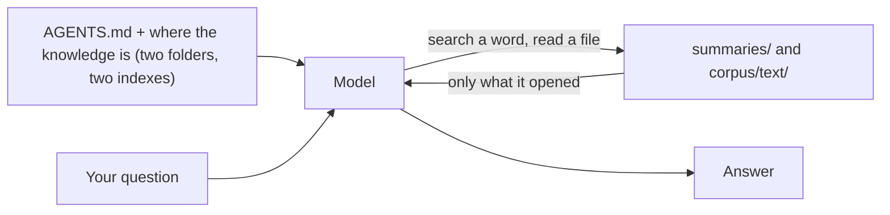
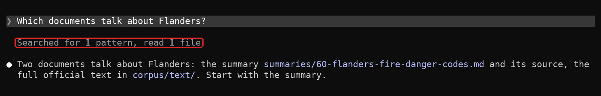
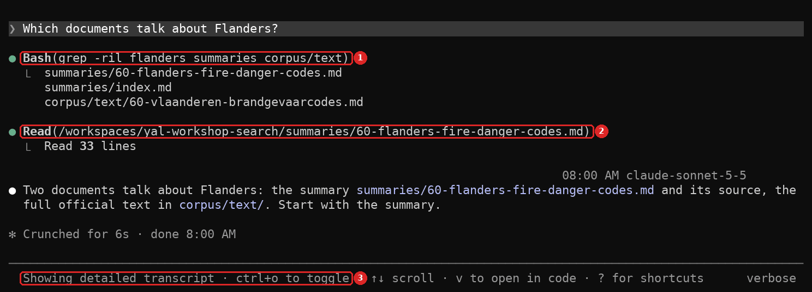
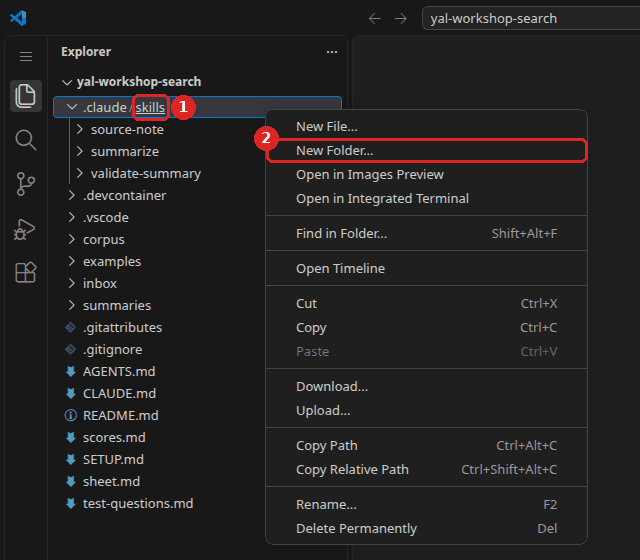
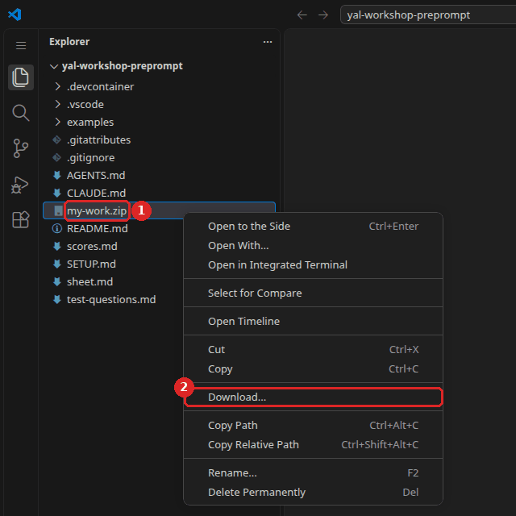

# Workshop 3 - Let it search, give it know-how

### Youth AI Lab (Erasmus+) - series "Build your own chatbot", workshop 3 of 6

- **Project:** Youth AI Lab (Erasmus+), with five partners: L.A.B. (Aix-en-Provence, France),
  UAB (Barcelona, Spain), Perlatecnica (Naples, Italy), Digitale Wolven (Antwerp, Belgium),
  CSC Vent des Îles (La Rochelle, France).
- **The series:** [the six workshops](https://github.com/Youth-AI-Lab/yal-workshop-kit#the-series)
- **Need help?**
  - Raise your hand and ask the facilitator.
  - If something breaks, don't panic: your files stay in the Codespace.

> 🎓 **Open your Codespace** (one per pair): 👉 **https://codespaces.new/Youth-AI-Lab/yal-workshop-search**
>
> **Before you click**, if the idle timeout of this GitHub account is not set yet: do
> [step 1 of SETUP.md](SETUP.md#step-1---let-the-codespace-wait-for-you) (1 minute).
>
> This link creates your own copy of this repository, in VS Code running in your browser. Nothing
> to install. The detailed steps are in [Part 1](#part-1---welcome-20-min).

> 📚 **The slides of the facilitator:** https://youth-ai-lab.github.io/yal-workshop/3/ (the same
> words as this page). **The short version** of this page, on one page: [sheet.md](sheet.md). The
> setup, the commands and the common problems of the whole series: [SETUP.md](SETUP.md).

### Contents

- [Goals of the session](#goals-of-the-session)
- [Part 1 - Welcome (20 min)](#part-1---welcome-20-min)
- [Part 2 - Let it search (★★, 20 min)](#part-2---let-it-search--20-min)
- [Part 3 - Let a document in, and vouch for it (★★★, 35 min)](#part-3---let-a-document-in-and-vouch-for-it--35-min)
- [Part 4 - Write your own skill (★★★, 25 min)](#part-4---write-your-own-skill--25-min)
- [Part 5 - Closing (10 min)](#part-5---closing-10-min)
- [Troubleshooting](#troubleshooting)

---

## Goals of the session

### What you will be able to do by the end of this session

In workshop 2, the chatbot read everything (mode B), or a search engine picked pieces for it
(RAG). Today, **the model searches by itself**: it decides what to open, one step after another,
and you can read every step. Then you let a new document into its knowledge, and you sign what
the chatbot says about it. The question of the day is:

> **What if the model searched by itself?**

| Bloom level | Parts | You will be able to... | Mode |
|---|---|---|---|
| **Understand** | 2 | Read the steps of a model that searches files (list, search a word, read), and explain why its failures are visible. | `C` |
| **Apply** | 3 | Add an official document of your territory to the chatbot's knowledge, with `corpus-add`. | terminal |
| **Analyse** | 3 | Check a summary written by the model against the original document, sentence by sentence, and decide what to correct. | `C` |
| **Create** | 4 | Write a **skill**, a procedure the model follows when a request matches it, and test when it triggers. | `C` |

All session long, you go on testing your chatbot with the same questions. Today you fill column
**C** of `scores.md`, for questions 3, 11 and 12, and question 8 for workshop 4:
[Part 5](#part-5---closing-10-min) says what each one puts to the test. The scores stay the same:
**2** right and sourced, **1** honest but not enough, **0** wrong or invented
([test-questions.md, How to score](test-questions.md#how-to-score)).

### Why this approach?

Mode B paid for everything at every message. A RAG always gave pieces, even when the answer was
not in them. In mode C, **nothing is loaded in advance**: the model knows where the knowledge is,
in two folders that each have an index, and it searches like a person would. When a search finds
nothing, or nothing that answers, the model sees it, and it can say "I don't know".

Then comes the part that tools do not do for you: **curation**. A person decides which document
enters the knowledge, checks the summary that the model writes of it, and signs it with their
name. The model proposes, the person decides.

Last, you write a **skill**: a procedure in plain English, like an activity sheet, that the model
opens only when a request needs it.

### How this connects to WikiYouthBot

- **Part 3** is the *Data Box*: the group brings local documents, and someone checks what the
  chatbot will say about them.
- **Part 4** gives one skill per activity of WikiYouthBot (see the table in Part 4): "I Heard a
  Rumor" becomes a skill that checks a rumour against the documents.
- In an Open WebUI chatbot, the same search happens when the model has its knowledge base and its
  tools: see the [Open WebUI guide, What a chatbot is made of](https://github.com/Youth-AI-Lab/yal-openwebui-guide#what-a-chatbot-is-made-of).

The series goes on, one piece of the chatbot at a time:

- **Workshop 1**: the instructions, and how to test a chatbot
- **Workshop 2**: all the knowledge in the context, then a RAG
- **Workshop 3** (this one): the model **searches by itself**, and **skills**
- **Workshop 4**: tools that act outside, such as today's fire danger level
- **Workshop 5**: organise what it knows in a wiki, and pack the chatbot of your territory
- **Workshop 6**: fine-tune a small model, to sort messages before the chatbot

### Before you start

**Bring `my-work.zip`**, the file you saved at the end of workshop 2. It holds your system prompt,
your question 12 and your scores. Without it, the kit's example (Feurisson) becomes your system
prompt. **Bring also the address of the official page of your question 12**: in Part 3, it enters
your chatbot. No question 12 yet? Write one at the start of Part 3 (`test-questions.md`, section
"Question 12: your territory"), or curate the document of Benevento and score questions 3, 8 and
11 only. More in [SETUP.md, Before you start](SETUP.md#before-you-start).

### Reference documents

All of these are in your Codespace, in the file list on the left:

- `summaries/index.md` and `corpus/index.md`: the catalogues of the summaries and of the official
  documents. The model starts there.
- `inbox/README.md`: the document of the Province of Benevento, not in the corpus yet, and the
  command that adds it.
- `.claude/skills/`: the three skills of the kit (`summarize`, `validate-summary`, `source-note`).
- `test-questions.md` and `scores.md`: the test set and your score sheet.
- `SETUP.md`: setup, commands and common problems.

---

## Part 1 - Welcome (20 min)

**Goal**: open the Codespace of this workshop, bring back your work, and start Open WebUI in the
background for the closing.

### Step 1 - Open your Codespace and save your key

Follow [SETUP.md](SETUP.md#setup), steps 1 to 5, with the link at the top of this page: let the
Codespace wait for you, open it, save your key with `workshop-login`, check `Key OK`, and open a
second terminal.

> 💡 **If you use OpenCode.** Same commands, after `workshop-login --engine opencode`. In mode C,
> OpenCode searches with its own tools (`read`, `grep`, `glob`), and it asks you before **every**
> shell command and every file it writes. The
> [OpenCode guide, Part 4](https://github.com/Youth-AI-Lab/yal-opencode-guide#part-4---the-knowledge)
> shows the same kind of search in a chatbot folder.

> 💡 **If your key starts with `sk-or-` (OpenRouter).** Paste it in `workshop-login`, with no option:
> the key chooses OpenCode, and `score` and Open WebUI use OpenRouter too. `openwebui chatbot`, and
> skills or Open WebUI with the default model, DeepSeek V4 Flash: (not tested). Compare your own
> columns only: `score` writes the model under the table, and warns when two columns used different
> models. The chatbot figures of this page (cost, time, gauge, scores) were measured with Claude, not
> with this model.

> ⚠️ **Important.** **With young people and an OpenRouter key**, type `workshop-login --europe`.
> Requests then go only to Mistral, hosted in Europe, with zero data retention (it says it stores nothing).
> The default model is `mistralai/mistral-small-2603`. OpenRouter itself may still handle them elsewhere. The
> setting does not lift OpenRouter's 18+ rule or section 5.2 of its terms, and flagged content may
> be kept. Read
> [OpenRouter guide, Part 8](https://github.com/Youth-AI-Lab/yal-openrouter-guide#part-8---data-and-young-people)
> before any session with young people.

> ℹ️ **No Codespace?** The same repository opens on your own computer, with Docker and VS Code: see
> the [dev containers guide](https://github.com/Youth-AI-Lab/yal-devcontainer-guide).

### Step 2 - Bring back your work

1. **Drag `my-work.zip`** from your computer into the file list of the Codespace. If you
   downloaded it more than once, your browser may have named the newest one `my-work (1).zip`:
   drag that one, and type its exact name between quotes, for example
   `workshop-start 3 --from "my-work (1).zip"`.
2. In your first terminal, type:

   ```bash
   workshop-start 3 --from my-work.zip
   ```

   You should see `Restored from my-work.zip (saved on …)`: check that this date is the end of
   workshop 2. Then you should see the list of your restored files, and:

   ```
   Prepared for this workshop:
     - nothing needed: everything is already here.

   Ready for workshop 3.
   Today's page: README.md (Ctrl+Shift+V to read it as a page)
   First command: workshop C
   ```

   Without a save, type `workshop-start 3`: the "Prepared" line then says that `AGENTS.md` is now a
   copy of the Feurisson example.

> ℹ️ **Note.** **The first time you type `workshop C`** in this Codespace, Claude Code asks again
> whether you trust the folder. The choice proposed is `No, exit`: press the **down arrow** to choose
> `Yes, I trust this folder`, then **Enter**. If Claude Code closed, type `workshop C` again. More in
> [SETUP.md, step 4](SETUP.md#step-4---your-first-conversation).

### Step 3 - Start Open WebUI in the background

At the closing, you will see your chatbot, with its new documents, in Open WebUI. Its first start
takes a few minutes: start it now.

1. In your second terminal, type:

   ```bash
   openwebui start
   ```

2. Do not wait for it: go on with Part 2 in your first terminal. It ends with
   `Open WebUI is ready, …`.

> 🚫 **Warning.** **Never make port 3000 public** (Ports tab, Port Visibility). It is the numbered
> door through which you reach Open WebUI. This Open WebUI has no accounts: anyone with the link
> could use your key.

> 💡 **Tip.** **Checkpoint**: `Key OK`, `Ready for workshop 3`, and `openwebui start` running in the
> second terminal.

---

## Part 2 - Let it search (★★, 20 min)

**Goal**: watch the model search the files for two questions, read each of its steps, and compare
the gauge with mode B.

### What you will discover

- **Agentic search**: the model decides what to open, one step after another. You can read each
  step in the conversation.
- **Tools that read**: list a folder (`ls`), search for a word (`grep`), read a file. They do not
  ask for your permission. Writing a file does.
- **A visible failure**: when the documents do not hold the answer, a search finds nothing (zero
  results), or it finds files that do not answer. The model sees it, and so do you.

### What the model reads in mode C

On its own, a model cannot open a file. In mode C, it asks **Claude Code**, the program around it,
to list a folder, search for a word or read a file. What comes back enters the context, and the
model decides what to do next: another search, another file, or the answer. `workshop C` also adds
a short text to your system prompt. It says where the two folders are, and it tells the model to
start with the summaries, to go to the full documents for details, and to say which document it
used.



**Key insight:** in mode C, **the model decides** what enters the context, step by step. It reads
only what seems useful, so the gauge stays low. And you can check what it read, because every
step is shown.

### What to do

#### Step 1 - Start the chatbot in mode C

1. In your first terminal, type:

   ```bash
   workshop C
   ```

2. You should see the banner `Workshop: mode C. To quit: press Ctrl+C twice. …`, then the screen of
   Claude Code.

#### Step 2 - Question 3: an answer that is only in a full document

1. Open `test-questions.md`, copy question 3, and paste it in the conversation with
   `Ctrl+Shift+V` (`Cmd+V` on a Mac). It is about the access to forest massifs in Bouches-du-Rhône.
   Its answer is **not in the summaries**: only in the full text of an order, a legal decision of
   the prefecture. In workshop 2, in our test, the RAG missed it: the article that answers was never
   in its pieces. Can the model reach it by searching?
2. Above the answer, a grey line sums up the steps, for example `Searched for 1 pattern, read 2
   files`. Press **Ctrl+O** (also on a Mac) to see each step: which word it searched, which files
   it opened. The screen then says `Showing detailed transcript · ctrl+o to toggle`: **Ctrl+O**
   again brings you back to the conversation. Here with another question:

   

   
3. Look at the gauge. In our test on 2026-10-30, the model searched with `grep` in `summaries/`
   and `corpus/`, read the summary of Bouches-du-Rhône, then the full order in `corpus/text/`,
   without asking any permission, and the gauge showed about **23,000 tokens** ([a token](https://github.com/Youth-AI-Lab/yal-local-ai-guide/blob/main/how-an-llm-works.md#what-a-token-really-is) is a piece
   of a word). The gauge is a sum: what is always there, plus what the model opened. A simple
   "Hello" in mode C already fills about 8,000 tokens: the instructions, the tools, the list of
   skills. So here, the searches, the summary and the order added about 15,000 tokens
   (23,000 - 8,000). In mode B it was about 100,000 (measured after question 10): the whole kit is
   in the window, whatever the question. Your steps may differ: the model decides each time.

#### Step 3 - Question 7: an answer that exists nowhere

1. Ask question 7 of `test-questions.md`.
2. Watch the searches: which documents do they find, and do these documents answer the question?
   What does the model say? Compare with what the RAG did in workshop 2, where the model always got
   5 pieces.
3. **What this means.** A search can find documents about the same place and still bring no answer:
   the model reads them and sees that the figure is not there. A search can also find nothing at
   all. Either way, you can read what it searched and what it found, so the failure is visible. In
   workshop 2, in our test, the model also said that the answer was missing, but it could not look
   further than its 5 pieces. Here it chooses each search, so you can judge the search as well as
   the answer.

#### Step 4 - Leave

Press **Ctrl+C twice**. From mode C on, `/exit` works too, and `/context` shows in detail what
fills the context window.

> 💡 **Tip.** **Checkpoint**: you can name the files the model opened for question 3, and say what
> its searches found for question 7.

### Think about it

In mode B, nobody picked. In the RAG, a search engine picked. **Who picks in mode C, and how can
you check it?**

> **You built** a chatbot that goes to look for what it needs, and shows each step. **Reused in** a
> chatbot folder of your own: [OpenCode guide, Part 4](https://github.com/Youth-AI-Lab/yal-opencode-guide#part-4---the-knowledge).

---

## Part 3 - Let a document in, and vouch for it (★★★, 35 min)

**Goal**: add two documents to the knowledge of your chatbot: the plan of the Province of Benevento
(for question 11), then the official page of your question 12. For your page, let the model write
a summary, check it sentence by sentence, and sign it.

### What you will discover

- **`corpus-add`**: the command that adds an official document to `corpus/`, without changing it.
- **The skill `summarize`**: the model writes a draft summary in English, and a verification table
  that puts each sentence next to the passage of the original that supports it.
- **The skill `validate-summary`**: it records that **a person** checked the summary. The model
  must not sign it: its rules say so, and you read what it writes.

### The three layers of knowledge

| Folder | What it holds | Who writes it |
|---|---|---|
| `corpus/` | the official documents, **never modified**, and a readable copy of each in `corpus/text/` | the authorities; a program makes the readable copy (`corpus-add` for yours) |
| `summaries/` | short summaries in English of the official documents, 5 to 15 sentences each, one fact per sentence | the model, then a person checks it |
| `summaries/checks/` | the working folder of the check: the verification table of each summary written today | the model |

**Why a summary, if the model can read the full document?** A document can be long, and it stays
in its own language. The summaries are short and in English, so the model starts there, and opens
a full document for details or when the summaries are not enough. A summary can then be all it
reads for a question.

Every summary starts with a **header**: a few lines between two `---` that say where it comes from
and who vouches for it. Open `summaries/30-charente-maritime-vigilance-levels.md` to see one: its
last `verified` line carries the name of a person. `status: draft` means that no person has checked
the summary. `verified: … human:<name>` means that a person did, and `status: stable` follows. The
model reads this header too: `workshop C` tells it that `status: draft` means not yet checked by a
person. Today, 4 of the 17 summaries of the kit carry a person's name: look for "(human-reviewed)"
at the end of the lines of `summaries/index.md`.

**Key insight:** a wrong summary gives a wrong answer, with confidence. **Curation** means that a
person decides what enters the knowledge, and signs what the chatbot will say about it.

> ⚠️ **Important.** **Claude Code asks for your permission** before it writes or changes a file. In
> this part, the skills write files: read what it wants to write (green lines are added, red lines
> removed), then accept with **1. Yes**. The question looks like this:
>
> ```
>  Do you want to create …?
>  ❯ 1. Yes
>    2. Yes, and switch to accept edits (auto-approve file edits and common file commands) for this session (shift+tab)
>    3. No
>  Esc to cancel · Tab to amend
> ```
>
> **Never choose 2**: you would no longer see what it writes. Searching and reading do not need
> your permission. **Never approve a command that mentions `sudo` or `workshop-key`**: choose
> **3. No**. Such a command could read your key.

### What to do

#### Step 1 - Add the document of Benevento (question 11)

1. Open `inbox/README.md` and copy its `corpus-add` command. It is **one single line**, even if your
   screen cuts it. In the editor, `Ctrl+Shift+V` shows a file as a page; in the terminal, the same
   keys paste.
2. Paste it in your first terminal, outside a conversation, with `Ctrl+Shift+V`, and press Enter.
   You should see, in less than a second:

   ```
   Added: corpus/80-benevento-aib-2026.pdf (original, unchanged)
          corpus/text/80-benevento-aib-2026.md (readable copy, about 1,346 tokens)
   Next, in "workshop C": summarize corpus/80-benevento-aib-2026.pdf
   ```

Three things happened: the original PDF is kept unchanged in `corpus/`, a readable copy goes to
`corpus/text/`, and a line is added to `corpus/index.md`. Question 11 now has its document. Its
summary is optional today: the model can read the readable copy itself. So **do not follow the
`Next` line for now**: go on with Step 2, and curate the page of your question 12.

#### Step 2 - Add the page of your territory (question 12)

1. Type, with the address of the official page of your question 12, between quotes, and a short
   name:

   ```bash
   corpus-add "https://…" --name my-town-fire-rules
   ```

2. You should see the same three lines, with the number **81**, and maybe a line `To complete in the
   header of corpus/text/81-….md: description.`: it lists what the page did not say about itself.
   Open that file and replace `TO BE COMPLETED` in its header with a short text, and in the last
   line of `corpus/index.md` if it is there too. Do not type `corpus-add` again for this page: it
   would add a second copy, with the number 82.
3. **Open the readable copy** `corpus/text/81-….md` and check that the fact of your question 12 is
   in it. On some pages, the text is not in the page itself: your browser fetches it afterwards,
   with a small program called a **script**. `corpus-add` only downloads the page and does not run
   the script, so the copy is almost empty. For example, the map of a French prefecture gave only
   318 tokens: the fire danger level of the day was not in the copy.

> ℹ️ **Note.** **If your page is refused** (a scanned PDF, a page whose text is loaded by a script,
> or a site that refuses downloads: see [Troubleshooting](#troubleshooting)), or if its copy is
> empty, do Steps 3 to 6 with the document of Benevento instead: `summarize
> corpus/80-benevento-aib-2026.pdf`. Then read **80** instead of 81 in these steps, and ask
> question **11** in Step 6.

#### Step 3 - Let the model write a draft summary

1. In your first terminal, type `workshop C`, then ask, with **your** file name:

   ```
   summarize corpus/81-my-town-fire-rules.html
   ```

2. Look for the line `Skill(summarize)`: the model opened the skill, because your request matched
   its description. Press **Ctrl+O** to see its steps: does it read `corpus/text/81-…md`, and not the
   original, as the skill says? **Ctrl+O** again to come back.
3. Accept each file it wants to write (**1. Yes**). You can already read the summary there.

You should get two files, and a line in `summaries/index.md` marked "(draft, not verified)":

- `summaries/81-….md`: the draft summary, with `status: draft` and no `verified` line;
- `summaries/checks/81-….md`: the verification table, one row per sentence:

  ```
  | # | Sentence of the summary | Original passage (copied word for word) | OK? | Correction |
  ```

In our test on 2026-10-30, the summary of the Benevento document took 39 seconds and cost $0.12:
14 sentences, a table of 14 rows, and a contradiction with another summary pointed out, without
choosing. One row of the table even said itself that a count was "to be checked": exactly the kind
of row you check first.

#### Step 4 - Check each sentence yourselves

1. Open the table `summaries/checks/81-….md`.
2. Open the source next to it: right-click on it in the file list, then **"Open to the Side"**.
   - For a **web page**, open the readable copy `corpus/text/81-….md` (the original `.html` is
     the code of the page, hard to read), and if you want the official layout, the page itself in a browser tab.
   - For a **PDF**, open the original `corpus/81-….pdf`: it opens in a PDF viewer.
3. For each row: copy a few words of the original passage, search them in the source with
   `Ctrl+F`, and compare with the sentence. Dates and numbers are easy to compare in any language.

   Look for three kinds of error: a figure, a unit or a date that changed; a condition or an
   exception that was dropped ("except…", "from level…"); a sentence that says more than its
   passage. The passage is copied word for word, so it must be in the source. If you cannot find
   it, search for fewer words. If it is still not there, the row is wrong.

4. Fill the **OK?** column: `yes`, or write the right version in **Correction**, between the two
   `|` of the cell, without adding or removing a `|`. Save (`Ctrl+S`). You can also say it in the
   conversation instead, in Step 5: `I checked sentences 1 to 10, sentence 3 is wrong, it should be
   …`.

> ⚠️ **Important.** **Every row must be checked.** A general "it's fine" is not enough: the skill
> will list the rows that are not checked, and ask you to check them. **You** sign it, not the
> model.

#### Step 5 - Sign it

1. In the conversation, tell the chatbot, with your names. Keep these words: they match the
   description of the skill, and that is what opens it:

   ```
   Validate summary 81. I checked every row. My name is <first name last name>.
   ```

   or, if a sentence is wrong: `sentence 3 is wrong, it should be …`. In our test, a general "I
   checked summary 80, it is correct" was refused while the **OK?** cells were empty: the skill asks
   for every row.
2. The skill `validate-summary` applies only your corrections, shows you the corrected sentences,
   and asks you to confirm them. Accept the changes (**1. Yes**).
3. It adds to the header a `verified` line with `human:<first-name-last-name>`, and sets
   `status: stable`.

#### Step 6 - Check the result

1. Open `summaries/index.md`: under "Added during the session", your summary went from "(draft, not
   verified)" to "(human-reviewed)". Then open `summaries/81-…` and read its `verified` line, with
   your name.
2. Leave with **Ctrl+C twice**: this conversation has just read your document, so it would answer
   from memory.
3. Start `workshop C` again and ask your question 12 in this new conversation. Press **Ctrl+O**:
   does it open `summaries/81-…` or `corpus/text/81-…`?
   - `summaries/81-…`: the chatbot answers from the text you checked and signed.
   - `corpus/text/81-…` only: it answers from the full document, and your summary was not needed
     this time.
   - Neither: look at the words it searched, if it searched at all. They can show why it missed
     your document.

   **Ctrl+O** again, then leave with **Ctrl+C twice**.

> 💡 **Tip.** **Checkpoint**: `corpus/80-…` and `corpus/81-…` exist, and `summaries/index.md` says
> "(human-reviewed)" for your summary.

### Think about it

The model wrote the summary, and it was probably right. **Why is it a person's name, and not the
model's, in the `verified` line?** (Hint: if a young person reads a wrong date in the chatbot, who
is responsible for it?)

> **You built** a curation process: a person decides what gets in, and signs what the chatbot says
> about it. **Reused in** any chatbot: the *Knowledge* box is only as good as what you put in it.
> With young people: the *Data Box* of WikiYouthBot. In an Open WebUI chatbot, the documents of the
> knowledge base: [Open WebUI guide, Step 1 - Gather your documents](https://github.com/Youth-AI-Lab/yal-openwebui-guide#step-1---gather-your-documents-knowledge).

---

## Part 4 - Write your own skill (★★★, 25 min)

**Goal**: understand what a skill is, then write one for a task of your own, and test that it
triggers when it should, and only then.

### What you will discover

- **A skill** is a text file, `SKILL.md`, in its own folder in `.claude/skills/`, written in plain
  English, like a procedure for a colleague. No code.
- **When it is used**: at the start of a conversation, the model sees only the name and the
  description of each skill. When your request matches a description, it opens the skill and
  follows its steps.
- **The description is the trigger**: change it, and the skill triggers on other requests.

### A skill is an activity sheet for the chatbot

Think of your binder of activity sheets. The table of contents is on the table. When the group
needs a game or a debate, you open the right sheet and follow it, step by step. A skill works the
same way.

| | System prompt (`AGENTS.md`, workshop 1) | Skill (`SKILL.md`) |
|---|---|---|
| When the model reads it | always, with every message | only when a request needs it |
| What it says | who the chatbot is, and the rules for every answer | how to do one task, step by step |
| Who decides to use it | you: it is always there | the model, from the description |
| Cost in the context | the whole text, every time | a few lines, until it is used |

**Key insight:** a skill keeps a task the same each time it is used. The summary gets its
verification table, and the rules stay written down: `summarize` says "Never add a `verified`
entry yourself, and never mark a summary as checked." But a skill is only text: nothing forces the
model to open it or to follow it. So press **Ctrl+O** to check, and read what it wants to write
before you accept.

### What to do

#### Step 1 - Read a real skill

1. Open `.claude/skills/summarize/SKILL.md`, then press `Ctrl+Shift+V`.
2. Read the header between the two `---` lines: the `name` and the `description`. Would your request
   of Part 3, "summarize corpus/81-…", match it? "Validate summary 81…" opened `validate-summary` the
   same way: its words match the description of that skill.
3. Read the steps and the rules. Find the step that says which file the model reads, the step that
   creates the verification table, and the rule about `verified`. You saw all three at work in
   Part 3: the model did them because this text told it to.

#### Step 2 - Write a skill

Choose one of these ideas, or one of your own:

| Skill | What it does | In WikiYouthBot |
|---|---|---|
| `rumour-check` | takes a sentence heard somewhere and answers TRUE, FALSE or NOT IN OUR DOCUMENTS, with the source | I Heard a Rumor |
| `quiz-maker` | writes 5 multiple-choice questions for 12 to 15-year-olds from one summary, each with its answer and its source | SDG Bingo |
| `explain-for-kids` | rewrites a summary for a 12-year-old: short sentences, no jargon, the same figures and the same source | Chatbot Studio |
| `translate-summary` | translates a summary, keeps the figures, and marks the result as a draft to check | The Data Box |
| `press-questions` | prepares test questions in the categories of `test-questions.md`, each with its expected answer and source | The Press Conference |

Here is a complete example. In the file list, find the line `.claude / skills` (VS Code shows the
two folders on one line), right-click on the word `skills`, then **New Folder...**, and name it
`rumour-check`.



Then right-click on this new folder, then **New File...**, and name it `SKILL.md` (in capitals). Paste this text in it, and save (`Ctrl+S`):

```markdown
---
name: rumour-check
description: Checks a rumour about wildfires against the documents. Use when the user says "I heard that…", "is it true that…", or gives a sentence to check.
---

# Checking a rumour

1. Write the rumour as one short sentence.
2. Search summaries/ first, then corpus/text/ if needed.
3. Answer with one of three words: TRUE, FALSE, or NOT IN OUR DOCUMENTS.
4. Give the sentence of the document that proves it, and the name of the document.

## What you don't do

- Answer from what you know without a document: then the answer is NOT IN OUR DOCUMENTS.
- Say TRUE or FALSE when the documents disagree: say so, and give both.
```

For your own skill, keep the same four parts: a **name**, a **description** that says when to use
it, the **steps**, and what the model must **never** do.

#### Step 3 - Test when it triggers

1. **Leave and start `workshop C` again**, so that the model sees your new skill for sure.
2. Ask a request that should use your skill. For `rumour-check`: `I heard that in France, clearing
   the brush around your house is only a piece of advice.` You should see the line
   `Skill(rumour-check)`, then a search. Is the answer TRUE, FALSE or NOT IN OUR DOCUMENTS, with a
   source?
3. Ask a request that should **not** use it: `Hello, who are you?`
4. Now see that the description is the trigger. Change it, save, leave (**Ctrl+C twice**), start
   `workshop C` again, and test both requests again. If your skill already triggers when it should,
   try a description that says less: remove the sentence that starts with "Use when", and see what
   changes. Keep the version that triggers when it should, and only when it should. A skill that
   opens on "Hello" adds its text to the context for nothing, and it can force its format on an
   answer that does not need it.
5. Leave with **Ctrl+C twice**: Part 5 starts in the terminal.

In a real Codespace on 2026-10-30, this rumour used `rumour-check` twice out of two (`● Skill(rumour-check)`,
then a search in the documents), and "Hello, who are you?" used no skill. Each test filled about
11,000 to 12,000 tokens of the window.

> 💡 **Tip.** **Checkpoint**: your `SKILL.md` exists, it triggers on one request, and not on
> "Hello, who are you?".

### Think about it

**What goes in the system prompt, and what goes in a skill?** (Hint: what must the chatbot do for
every answer, and what only for one kind of request?)

> **You built** a skill. **Reused in** the skills of an OpenCode chatbot
> ([OpenCode guide, Part 5 - Skills](https://github.com/Youth-AI-Lab/yal-opencode-guide#part-5---skills)),
> and in any agent built on the same idea.

---

## Part 5 - Closing (10 min)

**Goal**: measure what today changed, on the questions that can show it. Then see your chatbot
outside the terminal, and save your work.

| Question | What it puts to the test today |
|---|---|
| 3 | an answer that is only in a full document: can the model reach it by searching? |
| 8 | something that changes every day: your starting point for workshop 4 |
| 11 | the document of Benevento, that you let in today |
| 12 | the page of your territory, whose summary you checked and signed |

### Step 1 - Replay and score column C

1. **Predict** on paper: which of questions 3, 11 and 12 will go up from column B to column C?
2. In your first terminal, replay the test set in mode C:

   ```bash
   replay C
   ```

   Under each answer, the line `What the model did:` lists what it read, searched and used, for
   example `used the skill rumour-check`. The questions of the test set are not rumours, so this
   example may not appear: in our test on 2026-10-30, no question used that skill. That test, with
   the 11 questions of the kit (no question 12): 1 min 42 and $0.30.
3. Score the questions of today, and question 8, which workshop 4 compares with its tool, with the
   help of the judge (no question 12: `score C 3 8 11`):

   ```bash
   score C 3 8 11 12
   ```

4. **Compare column C** with columns B and RAG in `scores.md`, for questions 3, 11 and 12, and with
   your prediction. Today only some questions are scored, so **the Total row means nothing here**:
   read the rows. Without a save, there are no columns B and RAG: compare with a neighbouring pair.

   > ℹ️ **Note.** At workshop 2, questions 11 and 12 were scored only if there was time. Rows 11 and 12
   > empty in columns B or RAG? Your answers came back with your save: score them first, with
   > `score B 11 12` and `score RAG 11 12` (no question 12: `score B 11` and `score RAG 11`).

5. **How to read the rows.** Questions 11 and 12 show what you let in: their documents entered
   today, so a rise comes from your curation. Question 3 shows the search. In mode B the full order
   was already in the context, so column B may already be right: the gain is in the gauge, about
   23,000 tokens against about 100,000. Against the RAG, the score can rise: in our tests, questions
   3 and 11 each got 1 in the RAG and 2 in mode C.

### Step 2 - Your chatbot in Open WebUI

1. In your second terminal, check that Open WebUI is ready, then type, with the name of your
   chatbot:

   ```bash
   openwebui chatbot --name "Feurisson"
   ```

2. Open the address, choose your chatbot, and ask your question 12. Your chatbot now has your
   documents, and it searches them itself. When it searches, a line appears above the answer: it
   starts with "Explored" after several searches, and with "View Result from" after one. Click it to
   see its searches, as with **Ctrl+O** in mode C.
3. Your skill did not come along: this chatbot gets your system prompt and your knowledge files. The
   skill stays in this repository, and Step 3 saves it in `my-work.zip`.

### Step 3 - Save your work, fill in the exit card

1. Type `workshop-save`, then right-click on `my-work.zip` → **Download...**. It holds your documents,
   your summary and your skill. Bring it to workshop 4.

   

   If your computer already has a `my-work.zip`, the new one may be called `my-work (1).zip`:
   bring the newest.

2. Take a blank card or a half sheet from the facilitator. This is your **exit card**. Answer alone, in a few words:
   1. In mode C, who decides what the model reads, and how can you check it?
   2. Why is a person's name, and not the model's, in the `verified` line of a summary?
   3. When does the model open a skill?

**Next:** [Workshop 4 - Plug in tools](https://github.com/Youth-AI-Lab/yal-workshop-tools). Open its own Codespace from that page, and
bring `my-work.zip`. Bring also the address of the official page that gives the fire danger level
of your territory, if it has one: in workshop 4, it goes into the tool's file.

---

## Troubleshooting

The common problems (key, Codespace, terminal) are in the
[Troubleshooting of SETUP.md](SETUP.md#troubleshooting).

**`File not found: …`** (from `corpus-add`) - Check the name of the file. For the Benevento
document, copy the command of `inbox/README.md` again: it is one single line.

**`Not added: almost no text could be read (…). A scanned PDF (only images)? Ask the facilitator.`** -
This PDF is a picture of a page, with no text inside. The chatbot could not read it. Choose
another document, or do Part 3 with the document of Benevento.

**`Not added: almost no text could be read (…). The page layout was not recognised. Ask the facilitator.`** -
This web page loads its text with a script, so there is almost nothing to read in it. Choose another
page (often the PDF of the same rule), or do Part 3 with the document of Benevento.

**`Could not download <address> (…)`** - Some websites refuse downloads. Save the document on your
computer, drag it into the file list of the Codespace, then give its file name to `corpus-add`,
with `--url "<address>"` so that the header keeps its source.

**Claude Code asks "Do you want to…?" before writing a file.** - This is normal: it asks each time a
skill writes or changes a file. Read what it wants to do, then accept with **1. Yes**.

**My skill does not trigger.** - Check its place and name: `.claude/skills/<name>/SKILL.md`, with
`SKILL.md` in capitals. Leave and start `workshop C` again, then check that your request matches its
`description`.

**`Open WebUI is not running. Type: openwebui start`** - Type `openwebui start` in your second
terminal, wait for `Open WebUI is ready`, then `openwebui chatbot` again.

---

Texts and screenshots: [CC BY-SA 4.0](LICENSES/CC-BY-SA-4.0.txt). Configuration and programs:
[EUPL-1.2](LICENSES/EUPL-1.2.txt). The official documents are not ours and are not covered: see
[their note](LICENSES/LicenseRef-Third-Party.txt) and [`REUSE.toml`](REUSE.toml).

*Youth AI Lab (Erasmus+) - Workshop 3 of the series "Build your own chatbot" - 2026*
